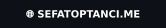
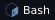

  
  

  

  

  
  
  
  
  

---

## About Me

I'm 19, and I've been working on software and cybersecurity since I was 16. I started without even owning a computer — I plugged a keyboard and mouse into my tablet and taught myself Python in Termux. Today I build my own security tools and share what I learn on YouTube.

I'm mostly into web application security, Linux systems and networking. Rather than only using existing tools, I write my own CLI tools in Python and Bash to automate the repetitive parts of testing. I run my labs on Kali Linux and Ubuntu virtual machines, and I spent a long stretch actively solving rooms on TryHackMe.

If there's one thing my own path taught me, it's this: if you really want to learn something, you can — whatever your circumstances.

## Currently

- 🧠 Learning AI in depth, together with the math behind it.
- 🐍 Adding new tools to [offsec-python](https://github.com/ffurares/offsec-python).

## Focus Areas

<table>
  <tr>
    <td width="33%" valign="top">
      <h4 align="center">⚔️ Penetration Testing</h4>
      Reconnaissance, service enumeration, vulnerability discovery and exploitation, practiced through CTFs, TryHackMe and my own lab.
    </td>
    <td width="33%" valign="top">
      <h4 align="center">🌐 Web Application Security</h4>
      OWASP Top 10: SQLi, XSS, IDOR and authentication flaws. Request/response analysis with Burp Suite, directory and parameter fuzzing.
    </td>
    <td width="33%" valign="top">
      <h4 align="center">🐧 Linux & Automation</h4>
      Linux privilege escalation vectors (SUID, cron, capabilities) and building security tooling in Python and Bash.
    </td>
  </tr>
</table>

## Projects

<table>
  <tr>
    <th align="left">Project</th>
    <th align="left">Description</th>
    <th align="center">Stack</th>
  </tr>
  <tr>
    <td valign="top">
      <a href="https://github.com/ffurares/ctf-toolkit"><b>ctf-toolkit</b></a>
    </td>
    <td valign="top">
      A menu-driven CTF and pentest automation tool for Kali Linux. Brings Nmap, Gobuster, Hydra, msfvenom and Metasploit together in one interface, with hash cracking/generation, ready-made reverse shell templates and VPN setup. <a href="https://www.youtube.com/watch?v=nd-b_aZUGv4">Video walkthrough (TR) →</a>
    </td>
    <td align="center" valign="top">
      
      
    </td>
  </tr>
  <tr>
    <td valign="top">
      <a href="https://github.com/ffurares/offsec-python"><b>offsec-python</b></a>
    </td>
    <td valign="top">
      A collection of Python security scripts written for learning and lab use: an Nmap-based port scanner and a socket-based backdoor example.
    </td>
    <td align="center" valign="top">
      
    </td>
  </tr>
</table>

## Tools & Technologies

  

**Recon & Network**

   

**Web Security**

  

**Exploitation & Password Attacks**

   

## Stats

  
  

## Contact

For collaboration or anything about my content: **contact.sefatoptanci@gmail.com**
Everything else: **[sefatoptanci.me](https://sefatoptanci.me)**

 

  <i>"The truest guide in life is science and knowledge."</i> — <b>Mustafa Kemal Atatürk</b> 🇹🇷

  

